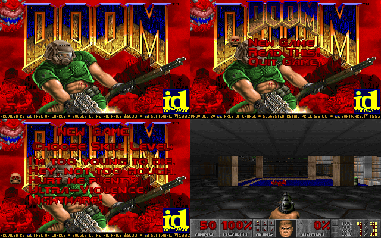
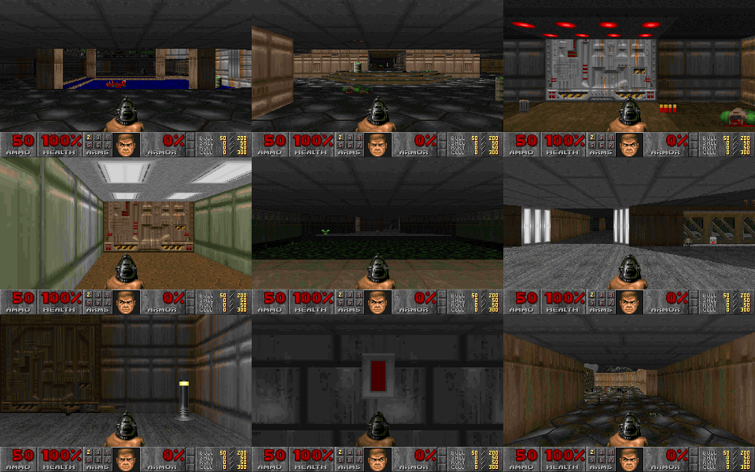
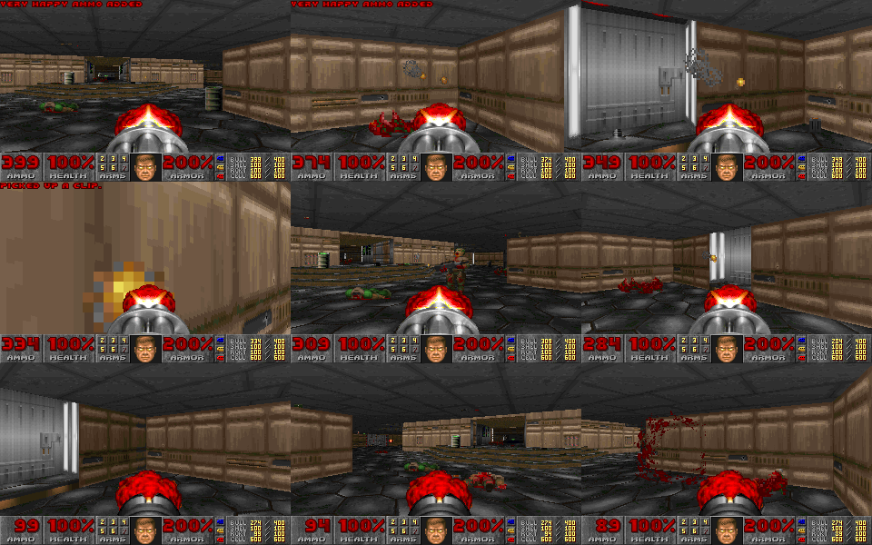
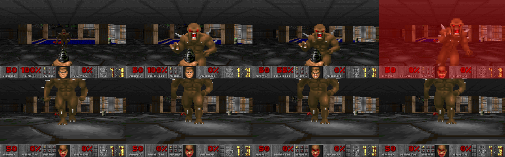
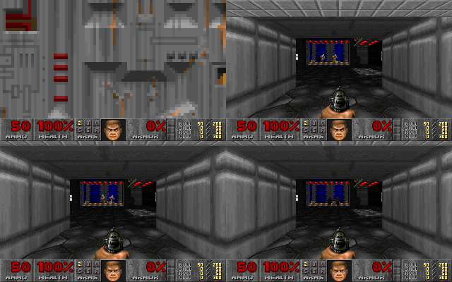
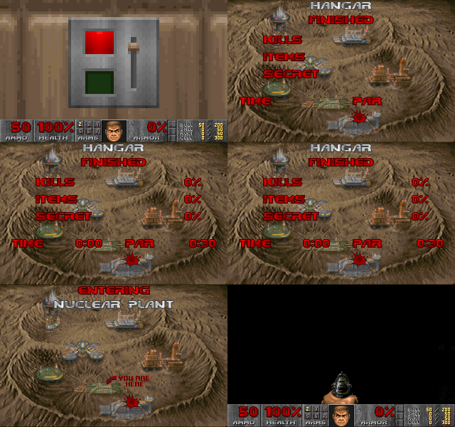

# DOOMF77: Genuine id Software Doom Engine in ANSI FORTRAN 77

A complete, WAD-driven, binary-compatible Doom engine implemented in fixed-form **FORTRAN 77** (uppercase, column 1-72 layout, labeled `DO`/`CONTINUE`, no recursion, common blocks).

**Zero C code is used.** All graphics and audio are presented through SDL2 called directly from Fortran using DEC pass-by-value (`%VAL`) and compile-time symbol renaming via `objcopy`.

---

## Screenshots

<p align="center">
  
  
</p>
<p align="center">
  
  
</p>
<p align="center">
  
  
</p>

---

## Key Features

- **Genuine Doom Architecture**:
  - Direct reading of raw `DOOM1.WAD` (shareware E1M1 through E1M9) directly from Fortran via direct-access unformatted records.
  - Front-to-back **BSP tree traversal** using an explicit stack (ANSI FORTRAN 77 has no recursion).
  - Perspective-correct wall rendering with upper, lower, and transparent masked middle textures (`R_MASKD`).
  - Correct texture pegging (upper pegged to ceiling, lower pegged to floor/ceiling depending on flags).
  - **Per-pixel floor and ceiling flat mapper** with 1024-column rotating sky projection (`SKY1`).
  - Authentic Doom light diminishing colormap tables (32 brightness steps + invulnerability inversion).
  - Depth-tested billboard sprite renderer supporting 8-angle rotations and optical fuzz shading for Spectres (`MFSHAD`).
  - Weapon view models (psprites) with raising/lowering animations, muzzle flash states, and bobbing.
- **Full Gameplay & Physics**:
  - Hitscan weapons (fist, pistol, shotgun, chaingun) with authentic auto-aim spread and puff/blood splats.
  - Projectile weapons (rocket launcher, imp fireballs, baron plasma balls) with splash damage and radius attacks.
  - Sector specials: doors (regular, blazing, keyed), lifts, stairs, switches, crushers, teleporters, scrolling walls.
  - Authentic monster AI state machine: Former Human, Shotgun Guy, Imp, Demon (Pinky), Spectre, Baron of Hell. Actions are dispatched via a deferred action queue (`P_RUNQ`) to avoid recursion.
  - Animated flats (nukage, water, lava, blood) and animated wall textures.
- **Audio & Sound**:
  - Full DMX sound effect loader (`DS*` lumps).
  - **8-channel positional stereo audio mixer implemented entirely in Fortran**, dynamically calculating 3D distance attenuation and angle stereo separation, fed into SDL2 audio queue.
- **UI & Menus**:
  - Interactive title screen with `TITLEPIC` and animated skull cursor main menu (`M_DOOM`).
  - Skill level selection menu (I'm Too Young to Die .. Nightmare).
  - Dynamic status bar (`STBAR`): health, armor, ammo counts, arms inventory, keys, and animated marine face reacting to damage direction, pickups, and god mode.
  - Full-screen automap (`Tab` key) drawing line geometry, player position arrow, and level title.
  - Authentic Intermission screen (`WI_DRAW`) with Phobos base map splats, "You Are Here" indicator, and percentage tallies for kills, items, secrets, and time vs par.
  - Episode 1 text finale typewriter screen (`F_DRAW`) on tiled `FLOOR4_8`.
  - Classic cheats supported: `IDDQD`, `IDKFA`, `IDFA`, `IDCLIP`.

---

## How It Compares to the Previous Version

| Feature | Previous Version (`doom-fortran`) | **DOOMF77** (This Engine) |
|---|---|---|
| **Architecture** | 24x24 Wolf3D grid raycaster | **Full WAD-driven Doom BSP engine** |
| **WAD Support** | Never loaded WAD; hardcoded ascii grid | **Full `DOOM1.WAD` parser (all lumps, textures, maps)** |
| **Levels** | Single 24x24 flat room | **All 9 shareware levels (E1M1 – E1M9)** |
| **Language Purity** | Used `term_io.c` (C wrapper for ANSI escapes) | **100% Fortran 77 (Zero C code, direct SDL2 link)** |
| **Output** | 80x48 ASCII half-block terminal output | **320x200 4:3 native scaled SDL2 window + Audio** |
| **Audio** | No sound | **8-channel stereo positional mixer in Fortran** |
| **Monsters & AI** | Single sprite static billboard | **Real AI state machine, projectiles, pathing, attacks** |
| **Line Specials** | None | **Doors, lifts, stairs, switches, teleporters, crushers** |
| **UI** | Primitive text line | **Title, Skill Menu, Status Bar, Automap, Intermission, Finale** |
| **Cheats** | None | **IDDQD, IDKFA, IDFA, IDCLIP** |

---

## Building and Running

### Prerequisites
- `gfortran` (GCC 7+ recommended)
- `SDL2` development libraries (`libsdl2-dev` on Debian/Ubuntu, `SDL2-devel` on Fedora/RHEL)
- `make`
- A shareware `DOOM1.WAD` file (bundled in this directory)

### Compilation
```bash
make clean
make
```

### Running
```bash
./doomf77
```

### Controls
- **Movement**: `W`, `A`, `S`, `D` or `Arrow Keys` (Forward, Strafe, Backward, Turn)
- **Speed**: Hold `Shift` to run
- **Strafe**: Hold `Alt` + `Left/Right` to strafe with arrow keys
- **Mouse**: Horizontal mouse look automatically turns the player
- **Fire**: `Left Ctrl` or `Left Mouse Button`
- **Use / Open Doors**: `Spacebar` or `E`
- **Weapon Selection**: `1` (Fist/Chainsaw), `2` (Pistol), `3` (Shotgun), `4` (Chaingun), `5` (Rocket Launcher)
- **Automap**: `Tab` (zoom with `-` and `+`)
- **Pause**: `P` or `Pause`
- **Menu**: `Escape`
- **Screenshot**: `F12` (saves `shotXXXX.ppm`)

---

## Test & Automation Environment Variables

The engine includes a built-in automated test harness controllable via environment variables:

| Variable | Description |
|---|---|
| `DOOM_WAD` | Path to WAD file (defaults to `DOOM1.WAD`) |
| `DOOM_WARP` | Warp directly to map `1`..`9` (e.g. `DOOM_WARP=1` for E1M1) |
| `DOOM_SKILL` | Skill level `1`..`5` (defaults to `3` = Hurt Me Plenty) |
| `DOOM_NOMONS` | Set to `1` to disable monster spawns |
| `DOOM_FAST` | Set to `1` to run without framerate throttling (thousands of FPS for benchmarks) |
| `DOOM_TICS` | Quit automatically after this many game tics |
| `DOOM_SCRIPT` | File containing scripted input commands (`<tic> <scancode> <value>`) |

### Example: Automated Headless Benchmark
```bash
SDL_VIDEODRIVER=dummy SDL_AUDIODRIVER=dummy DOOM_WARP=1 DOOM_FAST=1 DOOM_TICS=350 ./doomf77
```
Output:
```
LEVEL E1M1: HANGAR  SKILL 3
RAN 350 TICS, 350 FRAMES
AVERAGE FPS: 2600+ FPS
```

---

## Technical Architecture & Fortran 77 Design

1. **Fixed-Form ANSI FORTRAN 77**:
   All 14 source files adhere strictly to 72-column punch-card lines, uppercase syntax, explicit typed arrays, labeled loops (`DO 10 ... 10 CONTINUE`), and computed `GOTO` statements for action dispatch.
2. **Elimination of Recursion**:
   The BSP tree walk is implemented via an explicit stack (`STK(256)`) in `R_RENDER`. State transitions that would ordinarily re-enter the engine (such as monster deaths triggering recursive attacks or barrel explosions) are enqueued into `/ACTQ/` and processed iteratively by `P_RUNQ`.
3. **No C Helper Layer**:
   The engine avoids C wrapper code completely. `gfortran` translates `CALL SDL_INIT` to symbol `sdl_init_`. At build time, `objcopy` transparently maps each `sdl_*_` symbol to its real camel-case SDL2 library symbol (`SDL_Init`, `SDL_CreateWindow`, etc.). Arguments are passed by value via DEC `%VAL()`.
4. **Memory Layout**:
   Level structures and thing tables use Structure-of-Arrays (SoA) layout held in named `COMMON` blocks declared in `doomdef.inc`.

---

## File Overview

- `doomdef.inc`: Global dimensions, constants, lump structures, and common blocks.
- `w_wad.f`: WAD reader, directory lookup, binary decoders, and PPM screenshot dumper.
- `r_data.f`: Palette initialisation, colormaps, patch composite texture builder, flats, and fonts.
- `info.f`: State machines, sprite frame tables, mobj characteristics, and weapon definitions.
- `p_setup.f`: Map loading for E1M1–E1M9, thing spawning, sector line indexing, and bbox calculations.
- `r_main.f`: BSP stack walker, seg clipper, wall column texture mapper, and flat renderer.
- `p_map.f`: Collision detection, line tracer, hitscan auto-aim, radius damage, and sector checks.
- `p_mobj.f`: Mobj lifecycle, momentum, monster AI (look, chase, face, melee, missile), and action queue.
- `p_spec.f`: Doors, lifts, stairs, switches, teleporters, crushers, and light thinkers.
- `p_user.f`: Player input processing, weapon state machine, muzzle flashes, bobbing, and cheats.
- `s_sound.f`: DMX sound lump loader and 8-channel 3D positional stereo mixer.
- `st_stuff.f`: Status bar, ammo/health counters, marine face, automap, and palette tinting.
- `m_menu.f`: Title screen, main menu, skill selector, intermission screen, and episode finale.
- `i_sdl.f`: SDL2 video and audio platform driver using direct Fortran-to-C symbol linking.
- `d_main.f`: Main game loop (35 Hz fixed-tic timing), scripted test harness, and shutdown.
